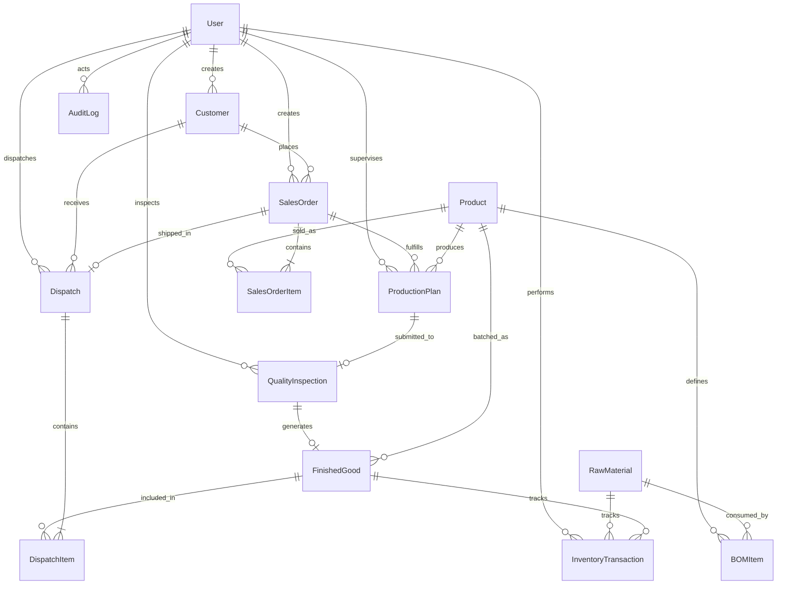

# FloData ERP — Database Schema Documentation

This document describes the complete data model, relationships, field constraints, indexing strategies, and lifecycle triggers for the **FloData ERP Discrete Manufacturing Platform**.

---

## 1. Entity Relationship Diagram (ERD)

---

## 2. Core Collections & Schema Specifications

### 2.1. Users Collection (`users`)
Stores operational staff, system administrators, and role authorizations.

- **Primary Model**: [`User`](file:///c:/Users/archi/Desktop/erp-system/backend/src/models/user.model.js)
- **Table / Collection Name**: `users`

| Field | Type | Required | Constraints / Validation | Description |
| :--- | :--- | :--- | :--- | :--- |
| `_id` | `ObjectId` | Auto | Primary Key | Unique document identifier |
| `name` | `String` | Yes | `minlength: 2`, `maxlength: 50`, `trim` | Full name of the user |
| `email` | `String` | Yes | Unique, lowercase, valid email regex | Login identifier |
| `password` | `String` | Yes | `minlength: 6`, hashed with `bcryptjs` | Salted password hash (excluded in queries by default) |
| `role` | `String` | Yes | Enum: `admin`, `sales_executive`, `inventory_manager`, `production_manager`, `quality_inspector`, `dispatch_manager` | Role-based authorization tier |
| `isActive` | `Boolean` | No | `default: true` | Account active status (controlled by Admin) |
| `refreshToken` | `String` | No | Stored hashed or plain token string | Refresh token for long-lived session rotation |
| `createdAt` | `Date` | Auto | Timestamp | Account creation timestamp |
| `updatedAt` | `Date` | Auto | Timestamp | Last update timestamp |

#### Hooks & Methods:
- **`pre("save")`**: Hashes `password` using 10 bcrypt salt rounds whenever modified.
- **`isPasswordCorrect(plainText)`**: Compares plaintext password against hash.
- **`generateAccessToken()`**: Issues JWT token signed with `ACCESS_TOKEN_SECRET` (includes `_id`, `email`, `role`).
- **`generateRefreshToken()`**: Issues JWT token signed with `REFRESH_TOKEN_SECRET`.

---

### 2.2. Customers Collection (`customers`)
Master client repository representing corporate buyers and consignment delivery points.

- **Primary Model**: [`Customer`](file:///c:/Users/archi/Desktop/erp-system/backend/src/models/customer.model.js)
- **Table / Collection Name**: `customers`

| Field | Type | Required | Constraints / Validation | Description |
| :--- | :--- | :--- | :--- | :--- |
| `_id` | `ObjectId` | Auto | Primary Key | Unique customer ID |
| `companyName` | `String` | Yes | `minlength: 2`, `maxlength: 100`, `trim` | Legal corporate name |
| `contactPerson` | `String` | Yes | `minlength: 2`, `maxlength: 50`, regex `/^[a-zA-Z\s]+$/` | Primary POC (letters & spaces only) |
| `email` | `String` | Yes | Unique, lowercase, email format | Official contact email |
| `phone` | `String` | Yes | Regex `/^\d{10}$/` | 10-digit mobile phone |
| `gstNumber` | `String` | No | Regex: 15-char Indian GSTIN (e.g. `27AAACA1234A1Z5`) | Tax identifier |
| `billingAddress` | `Object` | No | Embedded `addressSchema` | Billing address |
| `shippingAddress` | `Object` | No | Embedded `addressSchema` | Consignment delivery address |
| `isActive` | `Boolean` | No | `default: true` | Client operational status |
| `createdBy` | `ObjectId` | Yes | Ref: `User` | User who registered the client |
| `createdAt` | `Date` | Auto | Timestamp | Creation timestamp |

#### Embedded Schema: `addressSchema`
- `street` (`String`), `city` (`String`), `state` (`String`), `pincode` (`String`, 6-digit regex), `country` (`String`, default `"India"`).

#### Indexes:
- Text Index: `{ companyName: "text", contactPerson: "text", email: "text" }`
- Compound Filter: `{ isActive: 1, createdAt: -1 }`

---

### 2.3. Raw Materials Collection (`rawmaterials`)
Physical inventory master for components, fasteners, metals, and industrial consumables.

- **Primary Model**: [`RawMaterial`](file:///c:/Users/archi/Desktop/erp-system/backend/src/models/rawMaterial.model.js)
- **Table / Collection Name**: `rawmaterials`

| Field | Type | Required | Constraints / Validation | Description |
| :--- | :--- | :--- | :--- | :--- |
| `_id` | `ObjectId` | Auto | Primary Key | Unique material ID |
| `materialCode` | `String` | Yes | Unique, uppercase, `trim` (e.g. `RM-STL-01`) | Internal SKU code |
| `name` | `String` | Yes | `trim`, `maxlength: 100` | Material description |
| `unit` | `String` | Yes | Enum: `kg`, `meter`, `pcs`, `liter`, `sheet`, `box`, `roll`, `set` | Unit of measure (UoM) |
| `currentStock` | `Number` | Yes | `min: 0`, `default: 0` | Total physical on-hand stock |
| `reservedQuantity` | `Number` | No | `min: 0`, `default: 0` | Stock allocated to in-production orders |
| `minimumStockLevel`| `Number` | Yes | `min: 0` | Safety threshold triggering low-stock alert |
| `reorderLevel` | `Number` | No | `min: 0` | Reorder trigger threshold |
| `unitPrice` | `Number` | Yes | `min: 0` | Standard purchase cost per unit |
| `warehouse` | `String` | No | `default: "Main Warehouse"` | Storage bay / warehouse location |
| `isActive` | `Boolean` | No | `default: true` | Catalog active flag |
| `createdAt` | `Date` | Auto | Timestamp | Creation timestamp |

#### Virtuals:
- **`availableQuantity`**: `Math.max(0, currentStock - reservedQuantity)`. Computes uncommitted stock available for immediate production reservation.

---

### 2.4. Products Collection (`products`)
Catalog of manufactured finished goods and multi-tier Bill of Materials (BOM) recipes.

- **Primary Model**: [`Product`](file:///c:/Users/archi/Desktop/erp-system/backend/src/models/product.model.js)
- **Table / Collection Name**: `products`

| Field | Type | Required | Constraints / Validation | Description |
| :--- | :--- | :--- | :--- | :--- |
| `_id` | `ObjectId` | Auto | Primary Key | Unique product ID |
| `productCode` | `String` | Yes | Unique, uppercase, `trim` (e.g. `PRD-CHAIR-101`) | Finished good SKU |
| `name` | `String` | Yes | `trim`, `maxlength: 100` | Commercial product name |
| `category` | `String` | Yes | Enum: `Office Chairs`, `Executive Desks`, `Storage Cabinets`, `Conference Tables`, `Workstations`, `Accessories` | Product category |
| `unitSellingPrice` | `Number` | Yes | `min: 0` | Standard catalogue selling price |
| `description` | `String` | No | `trim`, `maxlength: 500` | Product specifications |
| `bom` | `Array` | Yes | Non-empty array of `bomItemSchema` | Bill of Materials recipe |
| `isActive` | `Boolean` | No | `default: true` | Active flag |
| `createdBy` | `ObjectId` | Yes | Ref: `User` | User who defined product & recipe |

#### Embedded Schema: `bomItemSchema`
- `rawMaterial` (`ObjectId`, Ref: `RawMaterial`, Required): Component material.
- `quantity` (`Number`, `min: 0.001`, Required): Quantity of component required to build **1 unit** of this finished product.
- `unit` (`String`, Required): Unit of measurement matching raw material UoM.

---

### 2.5. Sales Orders Collection (`salesorders`)
Order lifecycle orchestration engine capturing procurement deals, inventory reservations, and customer commitments.

- **Primary Model**: [`SalesOrder`](file:///c:/Users/archi/Desktop/erp-system/backend/src/models/salesOrder.model.js)
- **Table / Collection Name**: `salesorders`

| Field | Type | Required | Constraints / Validation | Description |
| :--- | :--- | :--- | :--- | :--- |
| `_id` | `ObjectId` | Auto | Primary Key | Unique order ID |
| `orderNumber` | `String` | Yes | Unique, format: `SO-YYYYMMDD-XXXX` | Auto-generated business order tag |
| `customer` | `ObjectId` | Yes | Ref: `Customer` | Client purchasing the goods |
| `items` | `Array` | Yes | Non-empty array of `orderItemSchema` | Line items in order |
| `totalAmount` | `Number` | Yes | `min: 0` | Order total monetary value |
| `status` | `String` | Yes | 9-Stage Enum: `draft`, `approved`, `inventory_checked`, `production_planned`, `in_production`, `quality_check`, `ready_for_dispatch`, `dispatched`, `delivered`, `cancelled` | Current lifecycle state |
| `priority` | `String` | No | Enum: `low`, `medium`, `high`, `urgent` (`default: "medium"`) | Fulfillment priority |
| `expectedDeliveryDate` | `Date` | Yes | Must be a valid date | Promised delivery deadline |
| `statusHistory` | `Array` | No | Array of `statusHistorySchema` | Audit trail of stage changes |
| `remarks` | `String` | No | Optional notes | Order remarks |
| `createdBy` | `ObjectId` | Yes | Ref: `User` | Sales executive / admin |

#### Embedded Schema: `orderItemSchema`
- `product` (`ObjectId`, Ref: `Product`): Product ordered.
- `quantity` (`Number`, `min: 1`): Quantity requested.
- `unitPrice` (`Number`, `min: 0`): Agreed unit selling price.
- `totalPrice` (`Number`, `min: 0`): `quantity * unitPrice`.
- `fulfillmentSource` (`String`, Enum: `inventory`, `production`, `mixed`, default: `"inventory"`).

---

### 2.6. Production Plans Collection (`productionplans`)
Shopfloor execution plans allocating workstation machines, operator shifts, and material batches.

- **Primary Model**: [`ProductionPlan`](file:///c:/Users/archi/Desktop/erp-system/backend/src/models/productionPlan.model.js)
- **Table / Collection Name**: `productionplans`

| Field | Type | Required | Constraints / Validation | Description |
| :--- | :--- | :--- | :--- | :--- |
| `_id` | `ObjectId` | Auto | Primary Key | Unique plan ID |
| `planNumber` | `String` | Yes | Unique, format: `PP-YYYYMMDD-XXXX` | Auto-generated plan identifier |
| `salesOrder` | `ObjectId` | No | Ref: `SalesOrder` | Linked sales order (or buffer) |
| `product` | `ObjectId` | Yes | Ref: `Product` | Product to manufacture |
| `quantity` | `Number` | Yes | `min: 1` | Target output quantity |
| `producedQuantity` | `Number` | No | `min: 0`, `default: 0` | Successfully fabricated units |
| `rejectedQuantity` | `Number` | No | `min: 0`, `default: 0` | Defective / scrap units |
| `stage` | `String` | Yes | 6-Stage Enum: `planned`, `material_issued`, `manufacturing`, `assembly`, `packaging`, `completed`, `cancelled` | Current manufacturing stage |
| `machine` | `String` | Yes | `trim`, default: `"Assembly Line 1"` | Allocated workstation / machine |
| `shift` | `String` | Yes | Enum: `morning`, `evening`, `night` | Operating work shift |
| `operator` | `String` | No | `trim` | Shopfloor lead operator |
| `supervisor` | `ObjectId` | No | Ref: `User` | Assigned production supervisor |
| `startDate` | `Date` | Yes | Planned start | Production start date |
| `endDate` | `Date` | Yes | Planned completion | Target completion date |
| `stageHistory` | `Array` | No | Embedded `stageHistorySchema` | Transition audit log |
| `remarks` | `String` | No | Notes | Execution remarks |
| `createdBy` | `ObjectId` | Yes | Ref: `User` | Production planner |

---

### 2.7. Quality Inspections Collection (`qualityinspections`)
Batch quality sign-off evaluating 4 physical parameters prior to Finished Goods receipt.

- **Primary Model**: [`QualityInspection`](file:///c:/Users/archi/Desktop/erp-system/backend/src/models/qualityInspection.model.js)
- **Table / Collection Name**: `qualityinspections`

| Field | Type | Required | Constraints / Validation | Description |
| :--- | :--- | :--- | :--- | :--- |
| `_id` | `ObjectId` | Auto | Primary Key | Unique inspection ID |
| `inspectionNumber` | `String` | Yes | Unique, format: `QC-YYYYMMDD-XXXX` | Quality report tag |
| `productionPlan` | `ObjectId` | Yes | Ref: `ProductionPlan` | Completed manufacturing plan |
| `product` | `ObjectId` | Yes | Ref: `Product` | Product inspected |
| `salesOrder` | `ObjectId` | No | Ref: `SalesOrder` | Linked order |
| `inspectedQuantity`| `Number` | Yes | `min: 1` | Total sample / batch inspected |
| `passedQuantity` | `Number` | Yes | `min: 0` | Units meeting QA specification |
| `failedQuantity` | `Number` | No | `min: 0`, `default: 0` | Defective units |
| `parameters` | `Object` | Yes | 4-Point Object (see below) | QA criteria evaluations |
| `status` | `String` | Yes | Enum: `passed`, `rework_required`, `rejected` | QA outcome |
| `generatedBatchNumber` | `String` | No | e.g. `FG-YYYYMMDD-XXXX` | Auto-generated FG batch tag |
| `inspector` | `ObjectId` | Yes | Ref: `User` | QA officer |
| `remarks` | `String` | No | Calibration & test notes | Inspection remarks |

#### Embedded Object: `parameters`
- `visualInspection`: Enum `["pass", "fail"]`
- `dimensions`: Enum `["pass", "fail"]`
- `weight`: Enum `["pass", "fail"]`
- `finish`: Enum `["pass", "fail"]`

---

### 2.8. Finished Goods Collection (`finishedgoods`)
Warehouse batches produced by manufacturing and approved by QC, available for dispatch fulfillment.

- **Primary Model**: [`FinishedGood`](file:///c:/Users/archi/Desktop/erp-system/backend/src/models/finishedGood.model.js)
- **Table / Collection Name**: `finishedgoods`

| Field | Type | Required | Constraints / Validation | Description |
| :--- | :--- | :--- | :--- | :--- |
| `_id` | `ObjectId` | Auto | Primary Key | Unique batch ID |
| `batchNumber` | `String` | Yes | Unique, format: `FG-YYYYMMDD-XXXX` | Lot / Batch identifier |
| `product` | `ObjectId` | Yes | Ref: `Product` | Finished SKU |
| `productionPlan` | `ObjectId` | No | Ref: `ProductionPlan` | Originating production run |
| `inspection` | `ObjectId` | No | Ref: `QualityInspection` | QA certification reference |
| `quantity` | `Number` | Yes | `min: 0` | Physical units on-hand |
| `reservedQuantity` | `Number` | No | `min: 0`, `default: 0` | Units committed to pending dispatches |
| `warehouse` | `String` | No | `default: "FG Warehouse Bay 1"` | Storage bay |
| `manufacturingDate`| `Date` | No | Defaults to current date | Production date |
| `isActive` | `Boolean` | No | `default: true` | Lot active status |

---

### 2.9. Dispatches Collection (`dispatches`)
Consignment manifests, carrier assignment, tracking numbers, and driver dispatch records.

- **Primary Model**: [`Dispatch`](file:///c:/Users/archi/Desktop/erp-system/backend/src/models/dispatch.model.js)
- **Table / Collection Name**: `dispatches`

| Field | Type | Required | Constraints / Validation | Description |
| :--- | :--- | :--- | :--- | :--- |
| `_id` | `ObjectId` | Auto | Primary Key | Unique dispatch ID |
| `dispatchNumber` | `String` | Yes | Unique, format: `DSP-YYYYMMDD-XXXX` | Consignment number |
| `salesOrder` | `ObjectId` | Yes | Ref: `SalesOrder` | Shipped order |
| `customer` | `ObjectId` | Yes | Ref: `Customer` | Recipient client |
| `invoiceNumber` | `String` | Yes | Unique, format: `INV-YYYYMMDD-XXXX` | Commercial invoice number |
| `items` | `Array` | Yes | Array of shipped items with batch numbers | Consignment items |
| `courier` | `String` | Yes | `default: "FloData Express"` | Logistics provider |
| `trackingNumber` | `String` | Yes | Unique, format: `TRK-...` | Consignment waybill tracking tag |
| `vehicle` | `String` | Yes | License plate (e.g. `MH-04-AZ-9921`) | Vehicle registration |
| `driver` | `Object` | Yes | `{ name: String, phone: String }` | Driver contact |
| `status` | `String` | Yes | Enum: `pending`, `in_transit`, `out_for_delivery`, `delivered`, `failed_delivery` | Carrier shipment state |
| `carrierEvents` | `Array` | No | Embedded `carrierEventsSchema` | Telematics milestone history |
| `dispatchedBy` | `ObjectId` | Yes | Ref: `User` | Logistics manager |

---

### 2.10. Inventory Transactions Collection (`inventorytransactions`)
Immutable audit ledger recording all physical stock additions, deductions, and transfers for both Raw Materials and Finished Goods.

- **Primary Model**: [`InventoryTransaction`](file:///c:/Users/archi/Desktop/erp-system/backend/src/models/inventoryTransaction.model.js)
- **Table / Collection Name**: `inventorytransactions`

| Field | Type | Required | Description |
| :--- | :--- | :--- | :--- |
| `_id` | `ObjectId` | Auto | Unique transaction ID |
| `transactionType` | `String` | Yes | Enum: `purchase`, `material_issue`, `production`, `dispatch`, `adjustment`, `scrap`, `return` |
| `itemType` | `String` | Yes | Enum: `RawMaterial`, `FinishedGood` |
| `rawMaterial` | `ObjectId` | Conditional | Ref: `RawMaterial` (if itemType = RawMaterial) |
| `finishedGood` | `ObjectId` | Conditional | Ref: `FinishedGood` (if itemType = FinishedGood) |
| `product` | `ObjectId` | Conditional | Ref: `Product` |
| `quantity` | `Number` | Yes | Signed quantity (+ positive for receipt, - negative for issue/dispatch) |
| `previousBalance` | `Number` | Yes | Balance before transaction |
| `newBalance` | `Number` | Yes | Balance after transaction (`previousBalance + quantity`) |
| `referenceType` | `String` | No | Enum: `SalesOrder`, `ProductionPlan`, `QualityInspection`, `Dispatch`, `ManualAdjustment` |
| `referenceNumber` | `String` | No | Reference document number (e.g. `DSP-20261017-1001`) |
| `remarks` | `String` | No | Audit explanation |
| `performedBy` | `ObjectId` | Yes | Ref: `User` |
| `timestamp` | `Date` | Auto | Immutable creation timestamp |

---

### 2.11. Audit Logs Collection (`auditlogs`)
Immutable security and governance log capturing user actions, administrative overrides, and system events.

- **Primary Model**: [`AuditLog`](file:///c:/Users/archi/Desktop/erp-system/backend/src/models/auditLog.model.js)
- **Table / Collection Name**: `auditlogs`

| Field | Type | Required | Description |
| :--- | :--- | :--- | :--- |
| `_id` | `ObjectId` | Auto | Unique audit log ID |
| `action` | `String` | Yes | Uppercase action tag (e.g. `CREATE`, `UPDATE`, `STAGE_CHANGE`, `LOGIN`, `DELETE`) |
| `resource` | `String` | Yes | Target resource (e.g. `SalesOrder`, `Customer`, `ProductionPlan`, `RawMaterial`) |
| `resourceId` | `String` | No | String identifier of modified entity |
| `user` | `ObjectId` | No | Ref: `User` (actor who executed the operation) |
| `userName` | `String` | No | Cached actor name |
| `details` | `Mixed` | No | Contextual metadata / changed payload |
| `ipAddress` | `String` | No | Client IP address |
| `timestamp` | `Date` | Auto | Timestamp of activity |

---

## 3. Database Indexes Summary

| Collection | Index Definition | Purpose |
| :--- | :--- | :--- |
| `users` | `{ email: 1 }` (Unique) | Rapid credential lookup on authentication |
| `customers` | `{ companyName: "text", contactPerson: "text", email: "text" }` | Multi-field search |
| `customers` | `{ email: 1 }` (Unique) | Prevent duplicate customer accounts |
| `rawmaterials`| `{ materialCode: 1 }` (Unique) | SKU lookup & uniqueness |
| `products` | `{ productCode: 1 }` (Unique) | Product identification |
| `salesorders` | `{ orderNumber: 1 }` (Unique) | Order lookups |
| `salesorders` | `{ status: 1, createdAt: -1 }` | Pipeline filtering & sorting |
| `productionplans` | `{ planNumber: 1 }` (Unique), `{ stage: 1 }` | Shopfloor queue filtering |
| `qualityinspections` | `{ inspectionNumber: 1 }` (Unique) | Inspection tracking |
| `finishedgoods` | `{ batchNumber: 1 }` (Unique), `{ product: 1 }` | FIFO inventory decrement |
| `dispatches` | `{ trackingNumber: 1 }` (Unique), `{ dispatchNumber: 1 }` | Waybill lookup |
| `auditlogs` | `{ timestamp: -1 }`, `{ action: 1 }`, `{ resource: 1 }` | Security audit querying |
